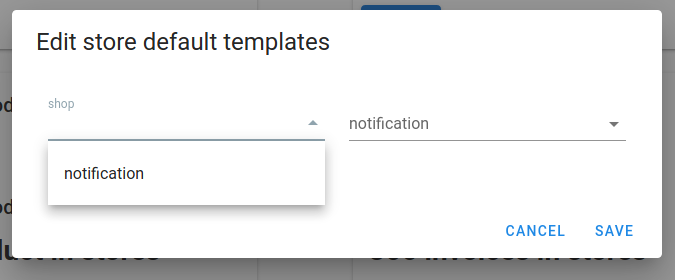

# Templates

Templates in Bitcart use the Jinja syntax and are rendered by a separate service using [MiniJinja](https://github.com/mitsuhiko/minijinja). It supports most Jinja2 features, see the [differences](#differences-from-jinja2).

There are currently 4 different templates you able to customize in Bitcart: `notification`, `product`, `shop` and `lightning_description`. Plus you are able to create custom-named templates for use with our future scripting language.

Check the example templates [here](../examples/templates.md)

For each of the objects, you are able to select a custom template.

The templates for an object are selected as per [template selection rules](../bitcart-basics/walkthrough.md#template-selection-rules)



## When a template fails

Bitcart refuses to save a template with a syntax error and shows the line and the error.

If a saved template fails while rendering, Bitcart sends the message with the default template:

* `notification`, `merchant_refund_notify` and `syncinfo` are sent to you, with the error added to the message.
* Messages to your customers use the default template, and the error is sent to you separately through your notification providers, or by email if none of them delivers it. You get at most one error message per template per store per hour.
* Customer emails also get an extra line from the `fallback_note` template, in case the default left out something the customer needed. You can customize that template too.

Each error includes the template name, the failing line and the error message.

To check a template before it is used, use the test button on the templates page. The test sends nothing and doesn't change metadata.

By default the test uses generated data, with text like `sample name`. You can enter a store ID instead, or a product ID for the `product` template. With a store, the test uses its latest paid invoice (or its latest invoice if none is paid) and its latest refund, if they exist. Generated values are placeholders: a check such as `` is false for them. When testing the `shop` template, products are rendered with the default `product` template.

## Differences from Jinja2

These make a template fail with an error, which you will see when testing it:

* `'%s' % value`, use `'%s' | format(value)` instead
* macro `varargs`
* the `wordwrap` filter
* `|length` on an undefined value

Dictionaries are always ordered by key: `{'b': 1, 'a': 2}` prints `a` first, and loops over a dictionary go in key order.

Exact numbers such as prices keep all their digits when printed and compared, and are printed in plain notation (`0.00000001` instead of `1E-8`). Math results are rounded to 28 significant digits, and a result with more than 9,999 digits or decimal places is an error.

Templates receive plain data instead of database objects, so object methods aren't available. The exceptions are `update_metadata` and `delete_metadata`, which still work on objects passed to the template. Their changes are saved only if the whole template renders.

Read metadata with `get_metadata`. Exact numbers are stored in metadata as text with all their digits, so convert them before doing math: `{{ get_metadata(store, 'key') | float * 2 }}`.

## HTML templates

Each template has a format, `text` or `html`, which decides how emails are sent. Values in html templates are escaped automatically, use `{{ value | safe }}` for a value you know is html.

An email is sent as html if any of its parts is html. Text parts are converted to html with their line breaks kept, so you can mix default templates with your own html ones. In an html `shop` template, each item of `products` is the product's rendered html, and a filter such as `upper` changes its tags too.

If you had "Use HTML templates" enabled before this setting moved to templates, the templates used by that store were switched to the `html` format. Values in them are now escaped automatically, so check any of them that prints html from a variable.

If you have a decimal field that needs to be formatted properly using currency data (e.g. price), you can use the `format_decimal` filter to format it properly, passing key of field on the model.

```jinja
{{ invoice | format_decimal("price") }}
```

You can check html templates examples [here](../examples/templates.md).

## Available templates

### Notification

Notification template is used when building the message to be sent via all configured [notification providers](../bitcart-basics/walkthrough.md#notification-providers) to the merchant notifying of successful order (to start shipping, for example).

The are two variables passed:

* `store`, containing the store this notification belongs to
* `invoice`, containing the invoice that has been paid

You can use those two variables to build whatever message that fits the best for you.

The default template is the following:

```
New order from {{ invoice.buyer_email }} for {{ invoice | format_decimal("price") }} {{ invoice.currency }}!
```

An up-to-date version can always be found at this [link](https://github.com/bitcart/bitcart/blob/master/api/templates/defaults/notification.j2)

### Shop

Shop template is used when building the base message for a successful payment associated with a store. It may optionally include paid invoice products' templates.

The are two variables passed:

* `store` is the store the invoice is associated with
* `products` is a list of already rendered individual product's templates

You can use this template to provide some design for the order confirmation message sent to the buyer.

The default template is the following:

```
Welcome to our shop!
Thank you so much for your order!
Your summary is below:

{{product}}


If you've got any questions, email us at {{store.checkout_settings.support_email}}.

Best wishes, your {{store.name}}.
```

An up-to-date version can always be found at this [link](https://github.com/bitcart/bitcart/blob/master/api/templates/defaults/shop.j2)

### Product

Product template is used when building the message for each individual product. Normally it is included as part of the main store message sent to the customer upon successful payment.

There are 3 variables passed:

* `store` is the store the product is associated with
* `product` is the current product being processed
* `quantity` is the quantity the customer has selected to buy

Note that, you can configure different templates for each product, or use the same template for all products.

The default template is the following:

```
Thanks for buying {{product.name}} x {{quantity|int}}!

Your download link: {{product.download_url}}

Your order is confirmed.

```

An up-to-date version can always be found at this [link](https://github.com/bitcart/bitcart/blob/master/api/templates/defaults/product.j2)

### Lightning description

Lightning description template is used when building the description of a Lightning invoice, which customers see in their wallet when paying. It is used by the built-in Lightning and by the [Lightning Network + plugin](lightning-network-plus.md).

There are 3 variables passed:

* `store` is the store the invoice is associated with
* `invoice` is the invoice being created
* `product` is the first product of the invoice, if it has any

The result is cut to 639 bytes, the most a Lightning invoice can hold. It is only rendered when a Lightning payment method is created.

The default template is the following:

```
{{ product.name }}Paid to {{ store.name }} (Order ID: {{ invoice.order_id }})
```

An up-to-date version can always be found at this [link](https://github.com/bitcart/bitcart/blob/master/api/templates/defaults/lightning_description.j2)
